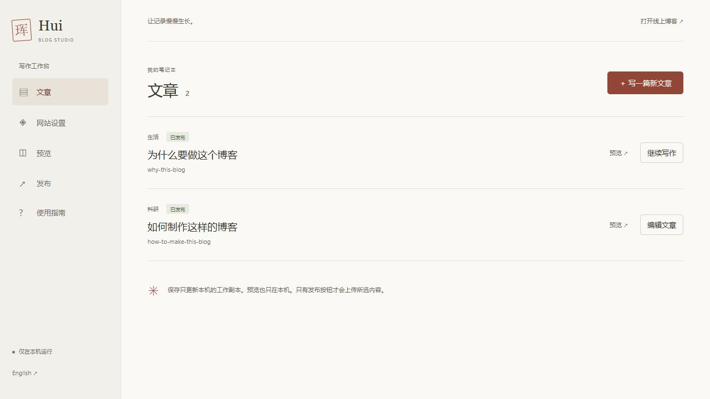
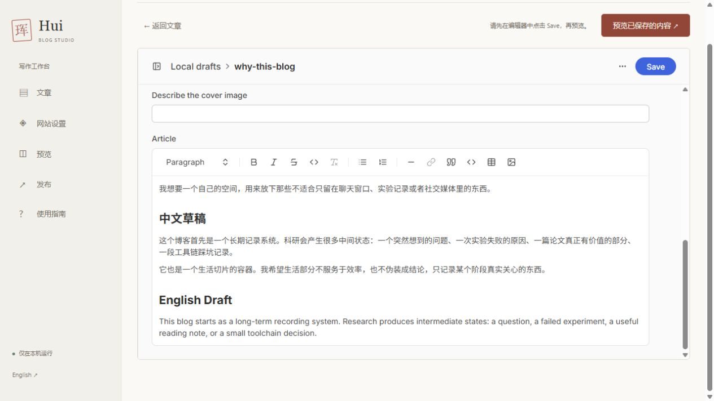
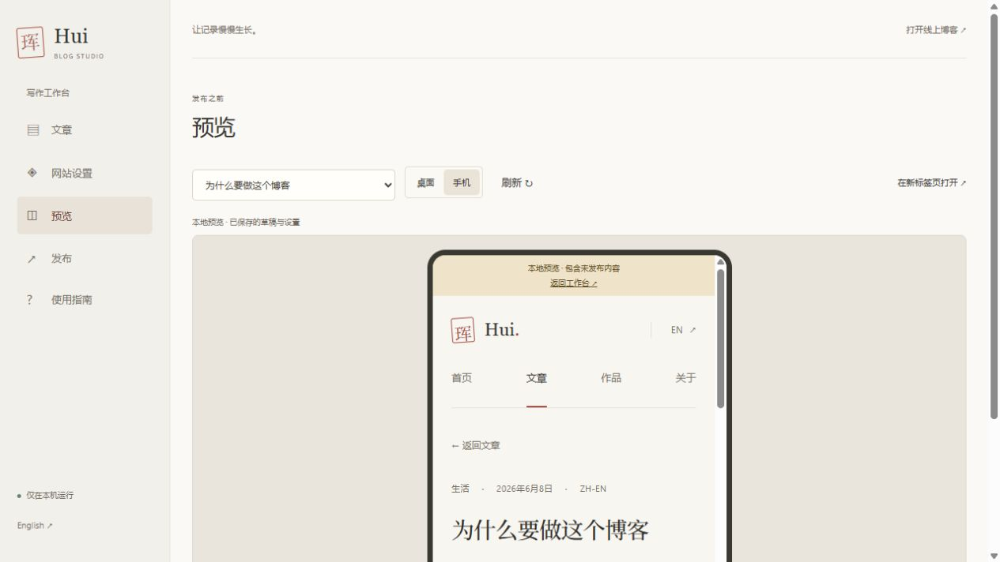
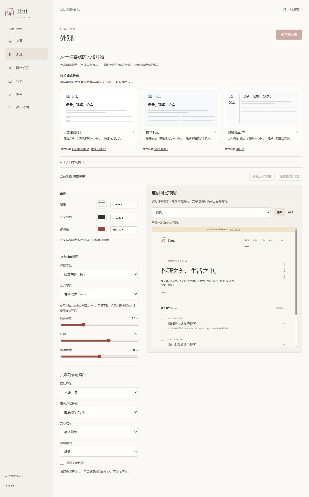

# Blog Studio 简明指南

## 1 · 启动 / Launch

在 `F:\Blog` 双击 **Open Blog Studio.cmd**。浏览器会打开本机工作台。第一次启动会准备项目专用 Node.js 24 和写作工具，需要联网；以后正常写作不需要终端命令。

第一次发布前，双击 **GitHub Setup.cmd**。回答 Git 登录提示，复制窗口中的一次性验证码，按 Enter 打开 GitHub，在浏览器登录 **Zjuhui**、输入验证码并授权 GitHub CLI。等到窗口显示登录完成，再回到工作台点击「发布 → 刷新」。凭据由 GitHub CLI 和系统凭据管理器保存，不放进博客文件。

## 2 · 写作 / Write

点击「写一篇新文章」，填写标题、网址、分类和正文语言。网址只用小写英文字母、数字和短横线，发布后保持不变。打开已发布文章会建立本机工作副本。

在可视化编辑器里写作。顶部填写摘要和日期；正文工具栏支持标题、粗体、链接、列表、引用、代码块、表格和图片。用 **Image** 插入正文图片，或 **Choose file** 设置封面。为图片填写有意义的替代文字。勾选 **Featured** 可标记精选文章；分类为 **Works** 的精选内容会出现在首页作品区。

点击编辑器右上方 **Save**。内置菜单保留英文，正文可自由混合中文与英文。

**Save 只保存到本机，不会更新线上博客。** 下次打开文章可继续写。编辑器尚未保存的文字不会进入预览，离开前先 Save。

## 3 · 预览与视觉设计 / Preview & design

点击「预览已保存的内容」，或侧栏「预览」。在下拉框选择首页或文章，切换「桌面 / 手机」。再次保存后点击「刷新」。这是实际博客模板，顶部浅色提示条表示正在查看本机草稿。

侧栏 **视觉设计 / Visual design** 和 **网站设置 / Site settings** 打开同一个设计工作区。前者从颜色与排版开始，后者从区块与文字开始。右侧预览会一起渲染当前的网站文字、区块、配色和字体，无需先保存；文章正文与图片仍需在写作编辑器里先点 **Save**。

### 点击页面，修改内容 / Edit the page

勾选 **点击页面区域进行编辑**，点击右侧预览中的网站标识、导航、介绍、文章标题区或页脚，左侧会打开对应设置。也可用「选择要编辑的区域」下拉框直接找到设置；隐藏的区块可从这里恢复。关闭这个勾选进入浏览模式，便可点击导航与文章链接检查页面。

页面文字可以留空。清空小标题、说明或短句后，对应文字和装饰也会隐藏；只输入空格视为留空。导航名称留空时隐藏该导航入口，已有页面网址仍然可用。网站名称留空时，浏览器标签使用页面标题；页眉中的「珲」和「Hui」由下方的文字标记与显示名称单独控制。要移除整个首页区域，在「首页区块」里取消勾选；以后仍可在这里恢复。

| 想改什么 | 在「区块与文字」中选择 |
| --- | --- |
| 隐藏「珲」或「Hui」，换成自己的名字 | **网站标识**：分别控制文字标记与名称；两个开关都关掉，页眉只显示导航。网站名称用于浏览器标题。 |
| 把「文章」改成「新闻」，把「作品」改成「经历」 | **导航与分类**：选择中文或 English 后分别修改。改名称不会改变已有网址，也不会改变文章分类。 |
| 让文章排在介绍前，或隐藏首页某一块 | **首页区块**：拖动排序，或使用上下箭头；取消勾选隐藏。这里也能调整首页文章数量。作品区只有存在精选作品时才显示。 |
| 修改首页介绍、各页说明、关于正文 | **首页介绍 / 文章区块 / 作品区块 / 关于页面 / 其他页面文字**。文字语言与工作台界面语言可分别选择。 |
| 修改页尾短句、社交链接或版权显示 | **页脚与链接**。页尾短句同时用于首页收尾区与页脚。 |

页面右上角切换语言时，文章正文保持原样。导航名称只改变显示文字：例如改成「研究」后，原有文章索引仍使用原来的网址。

### 一键风格与自由调整 / Presets & customization

1. 打开 **推荐风格**，选择 **开发者索引 / Developer Index**、**技术札记 / Technical Notes** 或 **侧栏笔记本 / Sidebar Notebook**。展开「个人日志风格」可选择温暖手记、简洁留白、林间笔记、夜读时分。切换预设只修改配色与排版，保留自己的文字、标识与首页区块选择。
2. 打开 **颜色与排版**，微调背景、正文与强调色；颜色支持拾色器或 `#RRGGBB`。标题和正文可分别选择黑体、宋体、楷体或代码等宽字体。字体使用设备本地字库，读者设备不同，字形可能略有差异。
3. 调整阅读字号、行距、宽度，选择列表、卡片或日期索引（日期索引隐藏列表摘要）。可以独立切换顶部 / 桌面侧栏导航、首页简介样式与文章目录。侧栏在手机上自动回到顶部；有两个或更多二、三级标题的文章可自动显示目录。文字颜色与背景对比不足时会提示，修正后才能保存。
4. 在右侧选择首页、文章索引、作品、关于页或文章，并切换中文 / English、桌面 / 手机。桌面预览按 **1024px**、手机按 **390px** 渲染；「适合窗口」会缩小整张页面，旁边显示缩放比例。检查实际字号时，点 **查看实际大小** 或 **全页预览**。全页预览仍使用当前未保存的网站设置。
5. 文章在编辑器保存后，点 **刷新文章**。如果某项输入暂时无效，预览会提示需要修正的字段，并保留上一次有效画面；完成输入后会重新渲染。
6. 预设区可用 **撤销上一次调整** 或 **恢复已保存外观**。这两个操作只影响配色和排版，不会清空介绍、文章或社交链接。
7. 点击顶部 **保存到本机**。下次启动可继续使用这些设置。上线时前往 **发布**，勾选 **网站设置**，检查内容并发布；未选择网站设置时，设计调整不会上线。

预览状态有明确区分：**未保存修改**是正在尝试的设计；**已保存的本地内容**包含本机草稿；只有发布完成后的线上博客才是公开版本。关闭工作台前请保存需要保留的修改，浏览器中的未保存状态不能替代草稿备份。

English: **Visual design → click a page area or choose Sections & text → edit labels, branding and section order → choose a preset or adjust Colors & type → inspect at 100% or in Full-page preview → Save locally → Publish → select Site settings → Review changes → Publish.** Turn off click-to-edit to browse links. Site settings preview immediately; article changes need the editor’s **Save** first. Previewing and saving never update the public website.

推荐布局的参考（2026-10-12 查阅）：

| Studio 风格 | 参考网站 | 采用的阅读方式 |
| --- | --- | --- |
| 开发者索引 / Developer Index | [Lee Robinson](https://leerob.com/)、[Tania Rascia](https://www.taniarascia.com/) | 紧凑简介、带日期的文章入口、清晰分类；适合快速浏览记录。 |
| 技术札记 / Technical Notes | [AstroPaper](https://astro-paper.pages.dev/) | 单栏文章摘要、克制排版、长文目录；适合教程与技术笔记。 |
| 侧栏笔记本 / Sidebar Notebook | [NexT](https://theme-next.js.org/) | 桌面侧栏导航、可跳转的文章目录；适合长期整理文章。 |

这些是结合「珲」的内容重新设计的布局，未复制参考站点的文章、品牌或完整主题。每张推荐卡片下都可打开参考网站。点击预设后仍可修改每项设置。

## 4 · 发布 / Publish

1. 打开「发布」，勾选这次要上线的文章和网站设置。未勾选草稿继续留在本机。
2. 点击「检查发布内容」，阅读本次上传的文件清单。只包含所选文章、设置和它们引用的图片。
3. 点击「发布到博客」。如果检查后又保存了文章，必须重新检查。
4. 等待 **检查并构建 → 上传中 → 网站部署中 → 发布成功**。只有 GitHub Actions 对应提交部署成功，工作台才显示成功。
5. 点击「打开线上博客」检查结果。生产地址是 `https://zjuhui.github.io/hui-blog/`。

发布期间重复点击不会开启第二个任务。草稿只有通过这个流程才会上线；Notion 不会被读取、改写或自动同步。

## 5 · 失败与恢复 / Recovery

| 提示 | 怎么做 |
| --- | --- |
| GitHub 未连接 / 登录失效 | 再运行 GitHub Setup.cmd，完成登录后刷新。 |
| 内容校验或构建失败 | 按错误提示修正内容，Save，预览，重新检查发布。草稿仍在。 |
| 远程内容变化 / 源码未同步 | 先备份 `.studio`。同步项目并比较本机草稿与已发布版本，解决冲突后重新建立编辑副本。不要强制推送。 |
| 已上传，部署失败 | 点击对应 GitHub Actions 链接，查看日志并重试失败任务。提交与草稿仍在。 |
| 暂时无法确认部署状态 | 保持工作台打开或刷新；状态会继续查询。此时尚未确认成功，不要重复发布。 |
| 启动失败 | 查看 `.studio/server-error.log`；确认 4321 端口未被其他程序占用。 |

需要撤回已发布内容时，可把原文重新保存为工作副本后发布。代码迁移前版本保留在 Git 历史，可通过新提交恢复。恢复已发布内容与保留未发布草稿是两回事，先做本机备份。

## 6 · 备份 / Back up

关闭编辑器前先 Save，然后定期把项目里的整个 **`.studio` 文件夹**复制到自己的备份盘。里面包含草稿、未发布图片和冲突检测基线。它被 Git 忽略，不会自动备份到 GitHub。

已发布内容和代码在 GitHub；历史 Markdown 草稿仍在 `content/`。换电脑时克隆仓库，并单独带上 `.studio`；详见 [换电脑指南](update-from-another-computer.md)。

日常英文操作顺序：**Open Studio → Write → Save → Preview → Review changes → Publish**。
